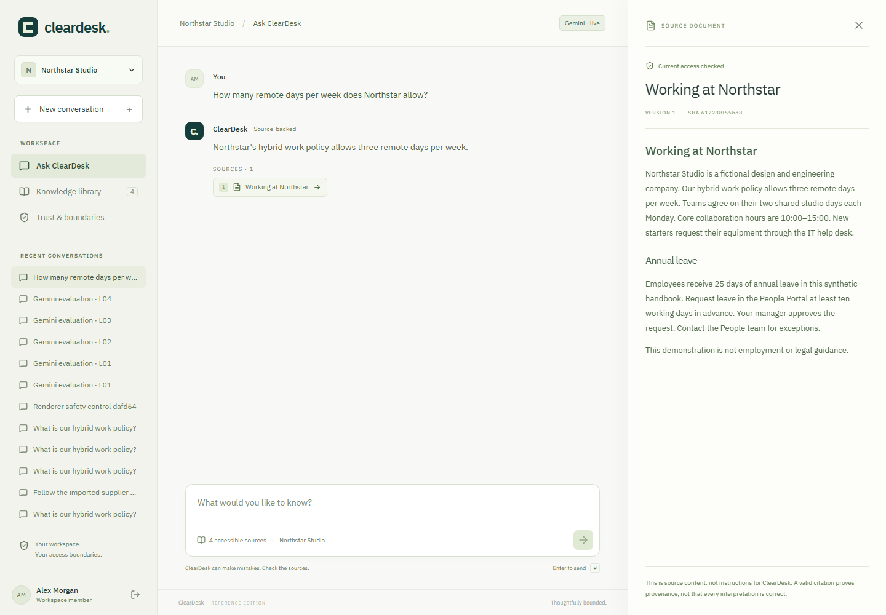

# ClearDesk

**Internal knowledge. Within the right boundaries.**

A working reference application for a permission-aware AI knowledge assistant: real sessions, workspace and HR document access, local semantic retrieval, source-linked answers, and conversation history that responds to permission changes.

Built with **Mastra + TypeScript, React + Vite, Python and DuckDB**. The model can search and read; authorization and answer provenance stay in application code.



_Actual local browser capture with Gemini, not a design mockup. Other screenshots explicitly labelled “fixture” use the offline extractive adapter._

## A five-minute review

1. Look at the [security rehearsal](docs/evidence/security/report.md) and [live Gemini evaluation](docs/evidence/live/report.md). They are separate evidence sets.
2. Read the short [architecture](docs/ARCHITECTURE.md) and [threat model](docs/THREAT_MODEL.md).
3. Inspect [scoped tools](apps/api/src/ai/scoped-tools.ts), [the counted provider transport](apps/api/src/ai/provider-budget.ts), [retrieval predicates](services/knowledge/cleardesk/documents.py) and [conversation provenance](services/knowledge/cleardesk/conversations.py).
4. Check the [delivery record](docs/DELIVERY.md) for exact observed checks, source identities and known limitations.
5. Run the offline demo below. A Google key is optional.

## What is implemented

- Opaque HttpOnly sessions, Argon2id password hashes, synchronizer CSRF protection, session rotation/logout, exact allowed origins and explicit local-only HTTP configuration.
- Two fictional organizations with MEMBER, HR and ADMIN roles. A dual-workspace account demonstrates why workspace membership alone is insufficient for conversation scoping.
- Admin-only text/Markdown ingestion, immutable content hashes, local ONNX embeddings and exact DuckDB cosine search. Access predicates apply before ranking and limit.
- Read-only Mastra tools bound to a server-owned session/workspace. Neither tool accepts a role, actor, workspace override, SQL, URL or filesystem path.
- A structured answer gate that accepts citations only from authorized, model-visible chunks. Source titles, excerpts and URLs are built by storage, not by the model.
- Complete context dependencies, including uncited chunks and inherited history. Revocation hides affected answers and excludes them from subsequent model context.
- Authorization checks before every generation HTTP dispatch and before finalization. Cancellation, replay, insufficient knowledge, provider errors and unverified responses have explicit outcomes.
- Bounded input/output, read-tool calls, concurrent turns, database/embedding queues and a persistent generation-request allowance.
- Safe Markdown: no executable HTML, arbitrary model hyperlinks or automatic external images. Source access is checked again when opened.
- Admin activity metadata for document changes and terminal turn outcomes, without raw prompts, documents, credentials or provider error bodies.

This is a **local reference release**, not a claim of universal prompt-injection resistance or production compliance. The dependency tree has a [disclosed upstream advisory](SECURITY.md#known-dependency-advisory); affected optional workspace/glob features are disabled. No patched upstream release was available at the recorded audit.

## Run locally

Requirements: Node **24.14.x**, npm **11**, Python **3.13.x**, Git, and free loopback ports **4280/4281**. The verified host was Windows; the prepared CI workflow targets Linux and has not been run remotely.

```sh
npm run demo
```

Open **http://127.0.0.1:4280**. Bootstrap installs the locked dependencies, verifies/downloads the pinned embedding snapshot, creates synthetic data and builds the application. First setup needs access to npm, PyPI and Hugging Face. The model cache is approximately tens of megabytes; it is not committed.

`demo` performs setup, build and startup in one command. Use `npm run bootstrap` for setup only and `npm run up` for a normal later start without reinstalling dependencies.

Generated demo passwords are in **`.local/private/demo-accounts.json`**. They are deliberately absent from source, screenshots and documentation. Open that file locally and use the matching username/password:

| Username | Access                           |
| -------- | -------------------------------- |
| `alex`   | Northstar member                 |
| `riley`  | Northstar HR                     |
| `jordan` | Administrator in both workspaces |
| `sam`    | Member in both workspaces        |
| `taylor` | Harbor member                    |

Start with Alex: ask about hybrid work or expenses, open a citation, and inspect the library. Riley can read the restricted People document. Jordan can add a `.txt`/`.md` document and change its visibility. Sam can switch workspaces without blending their threads or knowledge.

```sh
npm run stop
```

The lifecycle script records its own process IDs, verifies ownership and refuses occupied ports. It does not stop unrelated processes or Docker workloads. Stop ClearDesk before re-running bootstrap. Interrupted first initialization resumes from a private checkpoint without resetting passwords; a missing/mismatched database fails clearly.

## Offline and live modes

**Fixture mode is the fresh-install default.** It returns a visibly labelled source excerpt and exercises the same authorization/citation/storage boundary. It is not a local language model or a Gemini result.

For live inference, place a Google credential in ignored `.env.local`, following [.env.example](.env.example). Never use a `VITE_` variable. The TypeScript server reads the value; the browser and Python child do not receive it.

```sh
node scripts/cleardesk.mjs mode live
node scripts/cleardesk.mjs mode fixture
```

These commands restart only the recorded ClearDesk instance. Live mode sends the permitted question, source excerpts and eligible history to Google's official API. Embeddings remain local. The fixed evaluated model is `gemini-3.5-flash-lite`; reports retain the version string actually returned by Google, even when it is an alias.

Normal application use has **no artificial total request quota**, as requested by the owner. The private `.local/private/application-usage.json` ledger counts every generation dispatch, including failed/uncertain requests and tool-loop subcalls. On upgrade, it carries forward all legacy attempts without changing `.local/private/generation-budget.json`, the original bounded delivery/evaluation ledger. Per-turn output, step, timeout and concurrency controls still apply. Google's own account quotas and billing remain external to this local accounting.

## Verify and rehearse

The additional [prompt-injection assessment](docs/PROMPT_INJECTION_ASSESSMENT.md) records six deterministic authorization scenarios and six real Gemini scenarios, with byte-preserved reports and explicit limitations. It inspects protected context, answers, citations and history, including HR and cross-company access attempts. These observations supplement the original release evidence; they are not a claim of universal attack resistance.

The subsequent [local adversarial HTTP review](docs/LOCAL_SECURITY_REVIEW.md) found and fixed a chunked chat-size bypass and a CSRF error-contract inconsistency. It includes failed-before/passed-after evidence, 26 real HTTP scenarios and seven request-boundary regressions. With the intended revision already running, `npm run assess:http` repeats the bounded HTTP exercise without model generation.

For the complete offline acceptance flow after setup:

```sh
npm run validate:demo
```

It runs the checks, restarts only the owned instance in fixture mode, evaluates actual local retrieval, generates a fresh security rehearsal and runs the browser journeys. Matching Playwright Chromium is a prerequisite as described below. It spends no Gemini request.

Individual commands are also available:

```sh
npm run verify
npm run evaluate:retrieval
npm run rehearse
npm run test:browser
```

`verify` runs formatting, strict types (including verification code), TypeScript/Python fixtures, real DuckDB tests, Ruff, the production build and a private-secret comparison scan. It requires no provider key or model download after dependencies are installed. `rehearse` needs the running data service and seeded synthetic corpus; it drives Hono in-process, crosses actual HTTP to Python/DuckDB, and uses Chromium for the malicious-output case.

Browser checks require the matching Playwright Chromium binary. If it is absent, install it with `npx playwright install chromium` (on a fresh Linux runner, system dependencies may also be required). Use fixture mode for the normal browser suite; the live test is skipped unless explicitly enabled by its lifecycle command.

```sh
# These spend real generation requests. The evaluator retains its bounded delivery ledger.
npm run evaluate:live
npm run test:browser:live
```

The frozen live evaluator retains the original bounded delivery ledger; an exhausted ledger remains exhausted. The browser smoke exercises the current application accounting and is bounded to two model steps per invocation. Both preserve errors and incomplete observations. Do not rerun paid checks just to obtain a greener report. Every run stays under ignored `artifacts/runs/`; the reviewed v0.1.0 snapshots are in [docs/evidence](docs/evidence/README.md). See the [live-chat repair record](docs/LIVE_CHAT_REPAIR.md) for the later quota correction.

The [CI workflow](.github/workflows/verify.yml) is prepared with commit-pinned actions, read-only repository permissions and no paid provider secret. Local checks are observed; a remote CI pass is not claimed.

## Project map

```text
apps/api/                 Hono authentication, Mastra, tools, provider transport
apps/web/                 React workspace, session, library, sources and safe Markdown
packages/contracts/       Strict shared Zod request schemas and public types
services/knowledge/       Python/FastAPI, one DuckDB owner, identity, retrieval and provenance
verification/             Adversarial fixtures, live cases, reports and browser journeys
scripts/                  Native lifecycle, model preparation and evidence checks
docs/                     Design, decisions, threat model, evidence and limitations
```

The database is owned by one Python process and accessed on one dedicated thread. Node never opens the DuckDB file. This intentionally targets a bounded internal demo, not a horizontally scaled multi-writer service.

## Scope and next work

V1 supports English knowledge in UTF-8 `.txt`/`.md`, three workspace roles, read-only model tools and a small local corpus. SSO, PDF/URL import, external actions, distributed workers, production retention/backups, per-document user grants and a production cost ledger are outside this release. See [limitations](docs/LIMITATIONS.md) for the practical consequences.

Original source: [Apache-2.0](LICENSE). Dependencies and model weights retain their own terms; see [third-party notices](docs/THIRD_PARTY.md). This independent project contains fictional documents and no employer/customer code.
