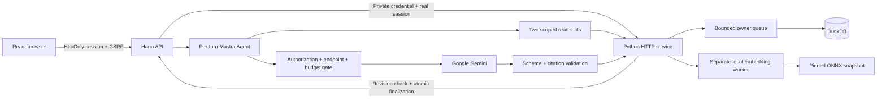

# Architecture

ClearDesk makes the model useful without making it the authority. Its two read tools are a small adapter over an authenticated data boundary.

## Component responsibilities

| Component          | Owns                                                                                                              | Does not own                                                             |
| ------------------ | ----------------------------------------------------------------------------------------------------------------- | ------------------------------------------------------------------------ |
| React/Vite         | Session view, workspace selection, chat, source drawer, admin forms                                               | Session credential storage, permissions or provider keys                 |
| Shared contracts   | Strict public input schemas and DTO types                                                                         | Authority inferred from browser/model JSON                               |
| Hono               | Cookie/CSRF/origin/host checks, admission, application routes, turn orchestration                                 | A second database connection or generic agent endpoints                  |
| Mastra             | Bounded model/tool orchestration with explicit authorized context                                                 | Automatic memory, filesystem/workspace tools, skills or external actions |
| Provider transport | Fixed official endpoint, tool namespace, current-access check, counted dispatch, bounded output and safe metadata | Silent retries/fallbacks, arbitrary URLs or raw-content logs             |
| Python             | Current session/membership resolution, document policy, immutable sources, history and finalization               | Trusting a model-supplied role or workspace override                     |
| DuckDB owner       | A creating-thread connection and serialized parameterized queries/transactions                                    | Multi-process writes or unsafe connection sharing                        |
| Embedding worker   | Pinned local FastEmbed/ONNX computation, separate bounded queue                                                   | Provider credentials or an open DuckDB handle                            |

## Identity and authority

Passwords are Argon2id hashes. Session tokens are random opaque values; only their SHA-256 digests enter DuckDB. A separate synchronizer CSRF value accompanies mutations. Login rotates both token and CSRF state; logout invalidates the persisted session. Session lookup resolves current user/memberships and server-controlled expiry.

Each useful data operation receives the private service credential and an actual session. `actor_context` derives user, selected workspace, current role and authorization revision from storage. A user belonging to both organizations still receives one selected workspace per operation. Foreign resources are unavailable even when their identifiers are known.

WORKSPACE documents are readable by all three roles in that workspace. HR documents are readable by HR and ADMIN. Only ADMIN can ingest, change visibility or soft-delete. There is no model write tool or public role-management endpoint.

## Retrieval and ingestion

The admin submits bounded UTF-8 text, a display filename, title and visibility. The display filename is never opened as a filesystem path. Chunking uses reproducible 1,000-character windows with 150-character overlap. Local embeddings are computed outside the database queue/transaction, then current admin authority and active-corpus bounds are checked again. Metadata, immutable text, hash, chunks and vectors become visible atomically.

DuckDB stores 384-dimensional finite FLOAT arrays. The exact cosine query joins documents/chunks and applies workspace, deletion and role predicates before ordering and limit. It does not take a global top-K and filter it afterwards. Human source reads recheck current authority; model source reads return at most six bounded chunks.

The embedding snapshot is `BAAI/bge-small-en-v1.5`, repository `Qdrant/bge-small-en-v1.5-onnx-Q`, revision `aa8f8b060edb00e03bfdd08813a2949946c8ba55`. Preparation records actual file hashes. Startup verifies the local manifest/files; a warm verified cache does not discover a newer remote revision.

## Turn lifecycle and provenance

1. Authenticate, validate the strict question/request key, and admit one turn per actor/two globally in this API instance.
2. Verify thread ownership and workspace. An existing identical request key replays its state without another model call; changed input conflicts.
3. Capture the workspace authorization revision. Include only currently accessible eligible history, and copy **all** inherited document/chunk dependencies to the new turn.
4. Retrieve initial authorized chunks and register them before they reach the model. Scoped read tools register further authorized chunks; complete dependencies are retained even when not cited.
5. Before **each** generation HTTP dispatch, recheck current access/revision and pending state, validate the fixed endpoint/tool surface, and durably reserve an attempt. The model receives no authority-changing fields.
6. Validate the structured response and every citation against the actual per-turn registry. Construct trusted source metadata from storage.
7. Recheck current authorization/revision before saving or returning. A changed revision discards the answer; cancelled/error/unverified turns remain explicit outcomes.

No raw answer tokens are streamed before these gates. Cancellation does not refund a request that may already have been dispatched. The unavoidable boundary is the authorization decision before dispatch: content already legitimately sent to a provider cannot be recalled when access changes later.

History rendering and future context both recheck all dependencies. Restricting an **uncited but model-visible** document hides the dependent assistant answer as well. This conservatively protects against an answer that incorporated information from more than its displayed citations.

## Storage and concurrency

Additive checksum-checked SQL migrations initialize identity, knowledge, conversations, context dependencies and safe activity metadata. Committed migrations are immutable. Model output is never SQL. The database disables external access and unsigned extensions.

One executor creates/uses/closes the connection. Its 32-operation admission remains occupied until the actual queued job completes, even if an HTTP waiter is cancelled. Embeddings have a separate four-slot/single-worker queue. The API waits for no extra model slots: excess concurrent turns are refused immediately.

The architecture assumes one API and one data process. It does not provide cluster-wide admission, replicated sessions, durable workflow resumption or a horizontally scaled DuckDB writer topology.

## Output and observability

Markdown rendering skips raw HTML, removes automatic images and renders arbitrary model links as text. Trusted source buttons carry identifiers and perform authenticated reads. Same-origin CSP, no-store responses, nosniff, frame denial and a restrictive referrer policy add browser defenses.

Application activity records use an allowlist of event codes and resource/actor/workspace identifiers. Raw prompts, documents, credentials and provider error bodies are excluded. Provider observations retain only bounded status/model-version/token metadata. Automatic Mastra memory, public framework routes, workspaces/skills and raw tracing/exporters are not configured.

## Key decisions

See [the decision record](DECISIONS.md). In particular: exact filtered retrieval instead of premature ANN infrastructure; explicit server-owned history instead of automatic agent memory; a single Python DuckDB owner; and provenance validation rather than treating a model refusal or citation-shaped text as a security guarantee.
