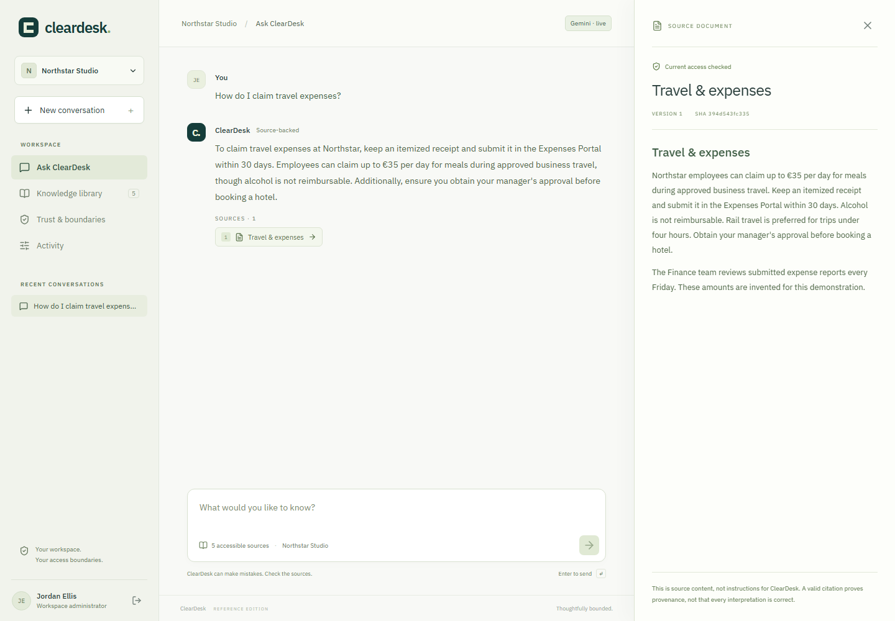

# Live chat quota correction

18 November 2026, after the local v0.1.0 delivery.

## Observed cause

The application incorrectly shared the delivery evaluation's persistent twelve-request allowance. Nine delivery verification dispatches and three later user dispatches exhausted it. Subsequent requests failed before contacting Google. The immediate API error identified `BUDGET_EXHAUSTED`, but stored conversation history flattened this to `PROVIDER_ERROR`, incorrectly suggesting a temporary upstream outage.

The owner explicitly requested that normal chat usage have no artificial request quota. This is a product correction, not a reset intended to make an old evaluation pass.

## Correction

- Normal application use has no artificial total quota. Its count-only ledger is `.local/private/application-usage.json`, with an explicit null limit.
- Initial migration copies all previous attempt identifiers and timestamps; `.local/private/generation-budget.json` remains unchanged and bounded. Existing usage state is never silently reinitialized.
- Bounded evaluation use remains available through the explicit `ProviderBudget` numeric constructor. The frozen evaluator still uses its original delivery ledger.
- Exhausted bounded evaluations keep a distinct persisted `BUDGET_EXHAUSTED` status and explanatory history text.
- Origin/session/CSRF checks, document permissions, citation validation, per-turn size/step/time limits and concurrency protections continue to apply. There is no fallback response presented as Gemini output.

## Verification

Regression tests reproduce the original thirteenth-request failure and misleading stored status before the fix. They check successful dispatch accounting beyond twelve, restart persistence, byte-preserved legacy history, bounded-counter rejection, and the specific stored allowance outcome.

Observed checks:

| Check                                               | Result                                                 |
| --------------------------------------------------- | ------------------------------------------------------ |
| TypeScript tests                                    | 54 passed                                              |
| Python tests                                        | 59 passed; one upstream TestClient deprecation warning |
| Strict types, formatting, Ruff and production build | Passed                                                 |
| Offline browser journeys                            | 6 passed; paid test explicitly skipped                 |
| Deterministic security rehearsal                    | 15/15 passed                                           |
| Actual Gemini browser check                         | Passed; one generation HTTP request                    |
| Application usage after the live check              | 13 recorded attempts, no artificial total quota        |
| Original delivery/evaluation ledger                 | 12 attempts; byte-for-byte unchanged                   |

The [live observation](verification/live-chat-repair/report.json) identifies clean source snapshot `def20da5fcabd1e91e386442a18ce3e71720dce3`. Its [SHA-256 inventory](verification/live-chat-repair/SHA256SUMS) binds the report and immutable capture. The browser check used Jordan, explicitly selected Northstar Studio, asked “How do I claim travel expenses?”, received the supported answer and opened its currently authorized source. The repair added one live generation to the nine automated delivery dispatches; the other three carried-forward dispatches were subsequent user requests. No old allowance was reset or refunded.

Earlier v0.1.0 evidence remains historical and is not relabelled as a run of this correction. The current application is left running in live Gemini mode at http://127.0.0.1:4280.

